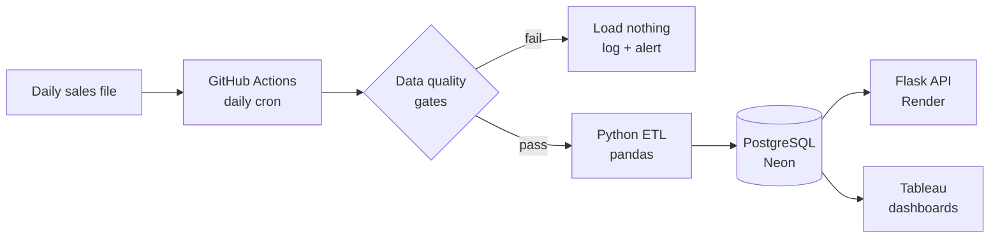

# StockPulse

**An automated inventory data platform.** Every day a scheduled pipeline loads that day's sales, updates stock for 2,500 SKUs, validates the data, flags items to reorder and perishables at risk of waste, and serves results through a REST API and Tableau dashboards. No human has to run anything.

> Built on a **synthetic** grocery dataset (2,500 SKUs, 8 suppliers, 90 days). Results are illustrative.

**Live API:** `<your Render URL>` · **Dashboards:** `<Tableau link>` · **Demo video:** `<link>`

## Architecture



| Layer | Tech |
|---|---|
| ETL | Python 3.12, pandas |
| Database | PostgreSQL (Neon or Supabase free tier); SQLite for local dev and tests |
| Scheduling & CI | GitHub Actions (cron, pull-request tests, API smoke test) |
| API | Flask + gunicorn on Render, auto-deploy from `main` |
| BI | Tableau |

## What makes it production-grade

- **Idempotent loads:** rerunning a day is skipped; `--force` reloads via upserts. Totals never double-count (tested).
- **Seven data quality gates** run before any write. On failure the pipeline **loads nothing**, logs the failed checks, and alerts.
- **All-or-nothing transactions** and **strict day ordering** (no gaps, no duplicates).
- **Every run is logged** in `pipeline_runs` and surfaced via `/pipeline-status` and the Platform Health dashboard.
- **24 automated tests**, CI on every PR, protected `main`.
- **Two simulated incidents** with blameless postmortems (`docs/`).

## Quick start (local, no cloud needed)

```bash
git clone https://github.com/<you>/stockpulse.git && cd stockpulse
python -m venv .venv && source .venv/bin/activate      # Windows: .venv\Scripts\activate
pip install -r requirements.txt

python -m stockpulse.pipeline init            # create tables, load seed data (local SQLite)
python -m stockpulse.pipeline backfill --days 10
pytest -v
flask --app api.app run                       # http://localhost:5000/low-stock
```

The dataset in `data/` is already generated. To regenerate: `python -m stockpulse.generate_data`.

## Cloud setup

1. **Database:** create a Neon (or Supabase) project and copy the connection string. Put it in `.env` as `DATABASE_URL=...` (see `.env.example`). Never commit it.
2. **Load history:** `python -m stockpulse.pipeline init` then `python -m stockpulse.pipeline backfill --days 30`.
3. **GitHub Secrets** (Settings → Secrets and variables → Actions): `DATABASE_URL`, optional `ALERT_WEBHOOK_URL`, and `API_BASE_URL` once the API is deployed.
4. **Protect `main`:** require the CI check to pass before merging.
5. **Render:** New Web Service from the repo (or use `render.yaml`). Build `pip install -r requirements.txt`, start `gunicorn api.app:app`, add `DATABASE_URL` as an environment variable.
6. **Tableau:** follow `docs/tableau-guide.md`.

The **Daily pipeline** workflow then processes one new day at about 11:00 UTC.

## API

| Endpoint | Returns |
|---|---|
| `GET /health` | API and database reachability |
| `GET /low-stock?limit=50&category=Dairy&on_order=false` | SKUs at or below reorder point, out-of-stock first, then fewest days of cover |
| `GET /sku/<sku>` | Product details, stock, days of cover, 14-day sales trend, open order |
| `GET /pipeline-status` | Last run, last success, hours since last success, 30-run success rate |
| `GET /supplier-performance` | Deliveries, on-time rate, average delay per supplier |

Example:

```bash
curl https://<your-app>.onrender.com/low-stock?limit=1
```
```json
{
  "as_of": "2026-08-29",
  "total_below_reorder_point": 1066,
  "count": 1,
  "items": [{
    "sku": "SKU00005", "name": "Coastal Bananas Value Pack", "category": "Produce",
    "supplier_id": "SUP01", "closing_stock": 0, "reorder_point": 36,
    "avg_daily_sales": 11.5, "days_of_cover": 0.0, "stockout": true,
    "on_order_qty": 68, "expected_delivery_date": "2026-08-27", "on_order": true
  }]
}
```

A Postman collection with tests is in `postman/`.

## Pipeline commands

```bash
python -m stockpulse.pipeline run                          # next day
python -m stockpulse.pipeline run --date 2026-06-10 --force  # reload latest day
python -m stockpulse.pipeline backfill --through 2026-07-01
python -m stockpulse.pipeline status
```

## Repository layout

```
stockpulse/      generate_data, db, quality, transform, pipeline
api/             Flask app
tests/           pytest suite (SQLite, no secrets)
sql/             schema.sql, verification_queries.sql
scripts/         smoke_test.py, make_bad_file.py (incident 1)
data/            seed/ and incoming/ daily replay files
postman/         API collection
docs/            charter, TDD, backlog, risk log, release plan, runbook, incidents, templates
.github/         CI, daily pipeline, smoke test workflows
```

## Project documents

[Charter](docs/charter.md) · [Technical Design](docs/tdd.md) · [Backlog & sprints](docs/jira-backlog.md) · [Risk log](docs/risk-log.md) · [Release plan](docs/release-plan.md) · [Changelog](CHANGELOG.md) · [Runbook](docs/runbook.md) · [Incident simulations](docs/incident-simulations.md) · [Tableau guide](docs/tableau-guide.md)

Postmortems and retrospectives go in `docs/` once written, using the templates provided.
