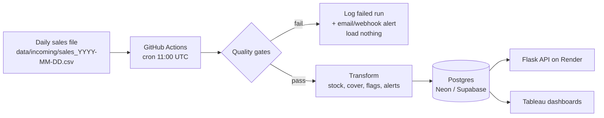

# StockPulse Technical Design Document

**Author:** Vijay Walunj · **Status:** Approved for build · **Version:** 1.0

## 1. Problem

Daily inventory reporting depends on one person running SQL and refreshing Tableau by hand. That creates three problems: data is late when the person is busy (timeliness), there's no check that the numbers are right before people act on them (reliability), and nobody else knows how to do it (key-person risk).

## 2. Current state

```
Sales export (CSV) → analyst runs SQL by hand → refreshes Tableau → managers read dashboard
```
No schedule, no validation, no run history, no alerting. A late or corrupt file is only noticed when a manager spots an odd number, if at all.

## 3. Target state



## 4. Components

| Component | Responsibility | Code |
|---|---|---|
| Data generator | Synthetic SKUs, suppliers, opening stock, 90 daily files | `stockpulse/generate_data.py` |
| DB layer | Postgres in prod, SQLite in dev/tests; upsert; transactions | `stockpulse/db.py` |
| Quality gates | Validate a file before load | `stockpulse/quality.py` |
| Transform | Pure functions: stock, cover, flags, order qty | `stockpulse/transform.py` |
| Orchestrator / CLI | init, run, backfill, status; logging; alerting | `stockpulse/pipeline.py` |
| API | Read-only JSON endpoints | `api/app.py` |
| Scheduler & CI | Workflows for tests, daily run, smoke test | `.github/workflows/` |

## 5. Data model

| Table | Grain | Key | Notes |
|---|---|---|---|
| `suppliers` | supplier | `supplier_id` | Promised lead time; `sim_on_time_prob` is a simulation-only parameter |
| `products` | SKU | `sku` | Category, perishable flag, shelf life, lead time, safety stock, reorder point |
| `daily_sales` | SKU × day | `(sale_date, sku)` | Demand as reported in the file |
| `inventory_snapshots` | SKU × day | `(snapshot_date, sku)` | Opening, received, sold, lost sales, closing, avg sales, days of cover, flags |
| `reorder_alerts` | order | `alert_id = sku-date` | Suggested qty, promised vs. simulated arrival, status open/received, delay |
| `pipeline_runs` | run | `run_id` | Date, status, rows, alerts, failed checks, error message, trigger |

Full DDL: `sql/schema.sql`. Views `v_latest_inventory` and `v_supplier_performance` feed Tableau.

## 6. Business logic

- **New stock** = yesterday's closing + units received − units sold. Sales are capped at available stock; the shortfall is recorded as `lost_sales`.
- **Average daily sales** = mean demand over the trailing 14 days including today (demand, not capped sales, so stockouts don't hide true demand).
- **Days of cover** = closing stock ÷ average daily sales (null if nothing sells).
- **Below reorder point** = closing stock ≤ reorder point, where reorder point = demand over lead time + safety stock.
- **Waste risk** = perishable, stock > 0, and days of cover > shelf life.
- **Reorder alert** created when a SKU is below reorder point and has no open order. **Suggested order qty** = reorder point + average demand × (lead time + review period) − closing stock. The review period is 7 days, shortened for perishables to half their shelf life.
- **Deliveries (simulation):** each order has a promised date (alert date + supplier lead time) and a simulated arrival date that's sometimes late, based on supplier reliability. Delay is deterministic per SKU and date, so reruns give identical results.

## 7. Pipeline guarantees

| Guarantee | How |
|---|---|
| **Idempotent** | A day already in `daily_sales` is skipped. `--force` reloads the latest day using upserts and undoes that day's receipts first, so totals don't change. Tested in `test_running_same_day_twice_never_double_counts`. |
| **All-or-nothing** | Gates run before any write; the load is a single transaction. On failure, only a `failed` row in `pipeline_runs` is written. |
| **Ordered** | Only `last loaded day + 1` can be processed, preventing gaps and duplicates. |
| **Observable** | Every run, including skips and failures, is logged in `pipeline_runs`, surfaced by `/pipeline-status` and the Platform Health dashboard. |
| **Alerting** | Non-zero exit makes GitHub email the repo owner; optional Slack/Discord webhook via `ALERT_WEBHOOK_URL`. |

## 8. Quality gates

| Gate | Catches |
|---|---|
| Required columns | Wrong file format |
| No missing SKU or date | Truncated or malformed rows |
| Quantities valid | Negative, fractional, or non-numeric `units_sold` |
| Known SKUs | SKUs not in `products` (catalog drift, wrong store's file) |
| No duplicate SKU rows | Double export |
| Expected date | Wrong day's file, gap, or duplicate day |
| Row count within ±10% of SKU count | Partial or empty file |

All gates run and all failures are reported together.

## 9. Failure modes

| Scenario | Detection | Behavior | Recovery |
|---|---|---|---|
| File late / missing | "file not found" | Run fails, nothing loaded, alert sent | When file arrives: `run` or `backfill` |
| File duplicated (same day rerun) | Date already loaded | Skipped, logged | None needed |
| File corrupt | Quality gates | Run fails, nothing loaded, alert | Fix or re-request file, then backfill |
| Wrong day's file | Expected-date gate | Run fails | Replace file, rerun |
| Scheduler starts late | Run timestamps | Data arrives late | Tolerated; freshness shown on dashboard |
| Schedule disabled (60 days inactive) | Freshness on dashboard grows | No runs | Push a commit / re-enable workflow |
| DB unreachable | Exception logged / `/health` 503 | Run fails | Retry; check Neon status |
| Bad API deploy | Smoke test workflow fails | Endpoint errors | Roll back on Render or `git revert` |
| Code bug in transform | Unexpected exception | Run fails, logged with error | Fix, test, merge, rerun |

## 10. Security

Connection strings live only in `.env` (gitignored), GitHub Secrets, and Render environment variables. The API is read-only. No real customer data is used.

## 11. Alternatives considered

| Choice | Alternative | Why this one |
|---|---|---|
| GitHub Actions cron | Airflow, cron on a VM | Free, no server to maintain, same platform as CI |
| Skip-if-loaded + upsert idempotency | Truncate and reload everything | Faster, safe, and keeps history |
| Trailing 14-day average | Forecasting model | Simple, explainable; forecasting is out of scope |
| Thin DB-API layer | SQLAlchemy ORM | Fewer dependencies; lets tests run on SQLite |

## 12. Open questions

1. Should `/low-stock` default to only SKUs with no open order? (Currently returns all below reorder point with an `on_order` flag.)
2. Should the pipeline catch up automatically if multiple days are missed, or always process one day per run?
3. What freshness threshold should trigger an alert (e.g. > 30 hours since last success)?
4. When the 90 replay days run out, extend the dataset or loop it?
